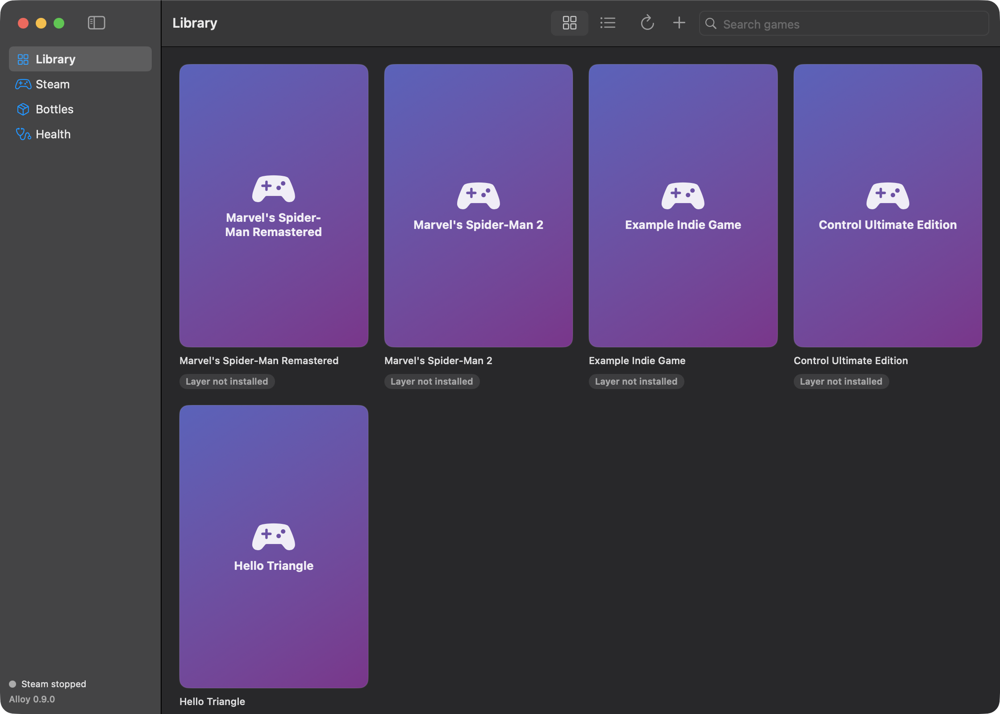
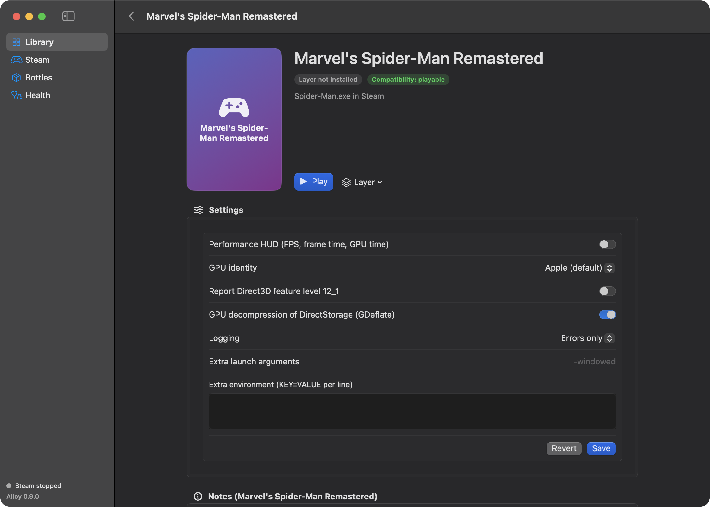
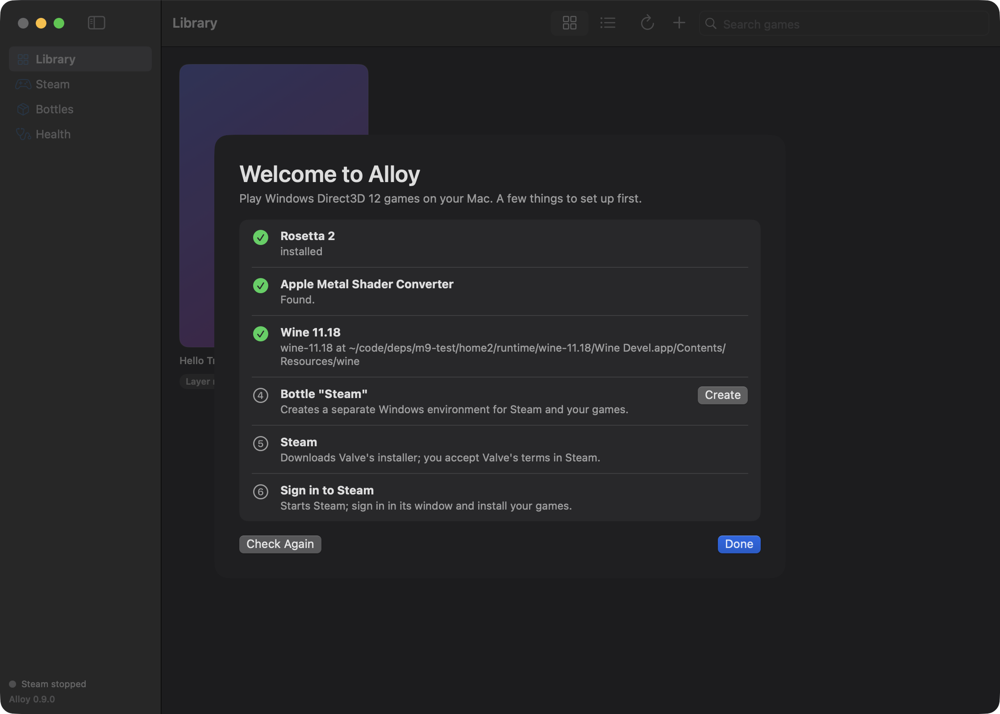
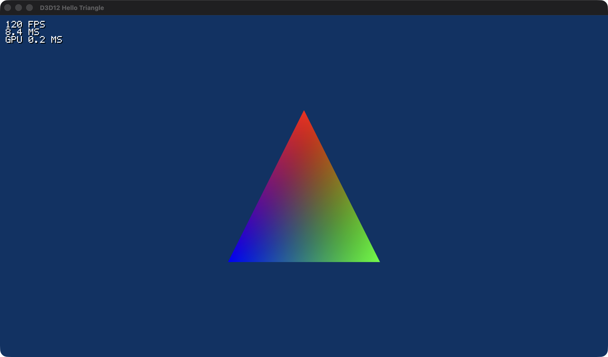
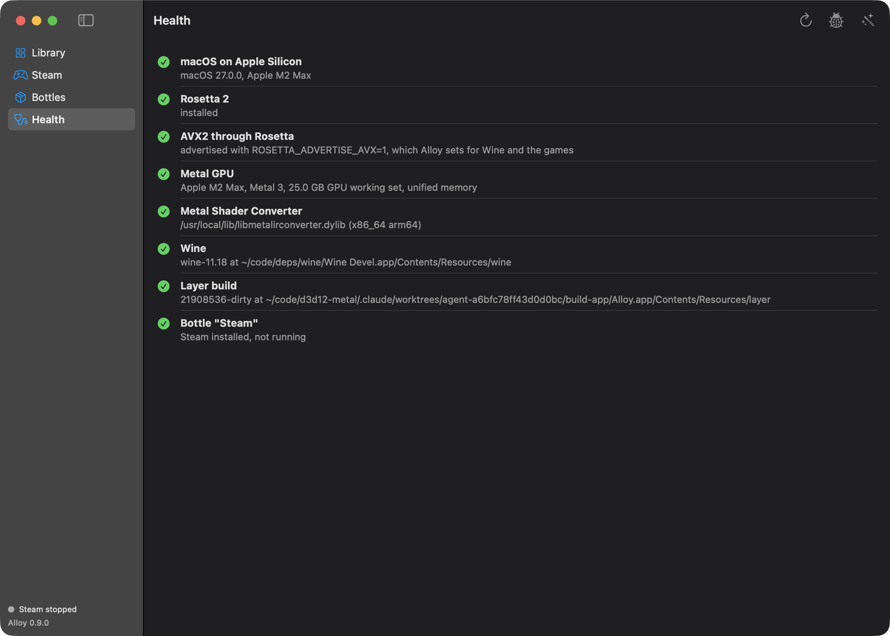

# Alloy

Play Windows **Direct3D 12** games on Apple Silicon Macs. Alloy is a from-scratch Direct3D 12 and DXGI implementation on top of Metal (the *Alloy translation
layer*, internally still called `d3d12metal`) that runs inside [Wine](https://www.winehq.org), with a native Mac app and a command line tool that set everything up: Wine, a
Steam bottle, the layer in each game, per-game settings and diagnostics.

The layer ships replacement `d3d12.dll` / `dxgi.dll`; games run unmodified. No game code or assets are part of this project.

> **Status: early.** Spider-Man Remastered is playable (about 55 to 60 fps on an M2 Max). Other games range from "boots" to "untested": see
> [docs/COMPATIBILITY.md](docs/COMPATIBILITY.md). Expect rough edges. Alloy is **build-it-yourself**: there are no binary downloads, you compile it on your Mac (one command, below).



| | |
|---|---|
|  |  |
|  |  |

## Requirements

To run:

- A Mac with **Apple Silicon** and **macOS 15 or newer**. (Rosetta's AVX2 support, which most modern games require, arrived in macOS 15; macOS 14 can build and run simpler games.)
- **Rosetta 2** (`softwareupdate --install-rosetta`). Wine runs as x86-64 code.
- **Apple's Metal Shader Converter**, installed from [Apple's developer site](https://developer.apple.com/metal/shader-converter/) (a free download). Apple's terms do not let us
  include it, so every user installs it once. The app and `alloy doctor` check for it.
- About 1 GB for Wine and the bottle, plus your games. **Wine** itself is downloaded by Alloy on first run (a pinned, checksum-verified Gcenx build); you do not install it.

To build (all of it is done by `tools/bootstrap.sh`, except the first two items):

- **Xcode** in `/Applications` (only for SwiftUI's macro plug-in: it need not be selected or licensed) and the **Xcode Command Line Tools**.
- Apple's Metal Shader Converter (above), needed to build and to run the layer.
- Homebrew packages `meson ninja cmake mingw-w64 directx-headers` (the script installs them).
- A **DirectXShaderCompiler** checkout and build (the HLSL compiler for the tests and the DXBC converter; the script fetches and builds it: 30 to 60 minutes the first time).

## Build it yourself

```sh
git clone <this repository> && cd d3d12-metal
tools/bootstrap.sh            # checks the machine, installs the brew packages, builds DXC if missing, the layer and the app
open build-app/Alloy.app
```

`tools/bootstrap.sh --help` lists the options (`--yes` to run unattended, `--no-app`, `--deps DIR`). Every step is skipped when its result exists, so it is safe to run again.
The steps by hand are in [docs/DEVELOPING.md](docs/DEVELOPING.md): `tools/build-dxilconv.sh`, `tools/build-wine.sh --dxc <dxc>`, `tools/build-app.sh`. The app is ad-hoc signed
and not notarized: it is meant to be built and run on the same Mac.

The first start opens the **Setup Assistant**: it checks Rosetta, points you to Metal Shader Converter, downloads Wine (checksum verified), creates a bottle, installs Steam and
starts it so you can sign in. Install your games in Steam; they show up in the Library.

## Use

In the app: pick a game, press **Install layer** (done for you on **Play**), then **Play**. Settings on the game's page: performance HUD, GPU identity, feature level, DirectStorage
GPU decompression, logging, extra arguments and environment. **Report a Problem** writes a zip of logs with personal paths removed.

From a terminal (everything the app does; `--json` for scripts):

```sh
alloy setup                 # Wine, bottle, Steam
alloy doctor                # what is missing and how to fix it
alloy steam start
alloy library               # games found in the bottles
alloy launch 1817070        # install the layer if needed, run first-launch setup, start the game
alloy config 1817070 --hud on
alloy logs 1817070
alloy report 1817070        # zip for a bug report
alloy uninstall 1817070     # restores every file it replaced
```

A game that is not in Steam: `alloy game add --name "My Game" --folder <dir> --exe Game.exe`. More in [docs/USER_GUIDE.md](docs/USER_GUIDE.md).

## Tested games

| Game | Status |
|---|---|
| Marvel's Spider-Man Remastered | playable |
| Marvel's Spider-Man 2 | boots (first splash; work in progress) |
| Control (DX12) | boots |
| Godot 4 (D3D12 renderer), Microsoft D3D12 samples | works (test programs) |

Details and what each needs: [docs/COMPATIBILITY.md](docs/COMPATIBILITY.md). Per-game settings live in [`profiles/`](profiles/) and are applied automatically.

## Troubleshooting

- **A game does not start, or says no GPU was found.** Run `alloy doctor`. In the game's settings try GPU identity "AMD" or "NVIDIA".
- **"Rosetta does not advertise AVX2".** Use macOS 15 or newer. The app sets `ROSETTA_ADVERTISE_AVX=1` for Wine and the games itself.
- **Steam's window is black.** Use `Steam > Start` in the app (or `alloy steam start`): it installs a small helper that makes Steam's browser draw under Wine.
- **First start takes minutes, later ones seconds.** The first run compiles the game's shaders; they are cached (`Preferences > Clear Shader Cache` resets them).
- **Logs.** The game page has **Open Logs**; `alloy logs <game>`. For a bug report use **Report a Problem**.

## Documentation

[USER_GUIDE](docs/USER_GUIDE.md) · [COMPATIBILITY](docs/COMPATIBILITY.md) · [DEVELOPING](docs/DEVELOPING.md) · [ARCHITECTURE](docs/ARCHITECTURE.md) · [STATUS](docs/STATUS.md) ·
[LICENSING](docs/LICENSING.md) · [CONTRIBUTING](CONTRIBUTING.md)

## Prior art

- [DXMT](https://github.com/3Shain/dxmt): D3D11 to Metal
- [vkd3d-proton](https://github.com/HansKristian-Work/vkd3d-proton): D3D12 to Vulkan
- Apple's D3DMetal (Game Porting Toolkit)

## Legal

Licensed under the **LGPL-2.1-or-later** ([LICENSE](LICENSE)); third-party components are listed in [THIRD_PARTY_NOTICES.md](THIRD_PARTY_NOTICES.md) and what may be redistributed in
[docs/LICENSING.md](docs/LICENSING.md). This project contains no game code or assets and works without modifying games. Never commit game binaries, assets, dumps or captures.
It is not affiliated with Apple, Microsoft, Valve or any game publisher; product names belong to their owners.
